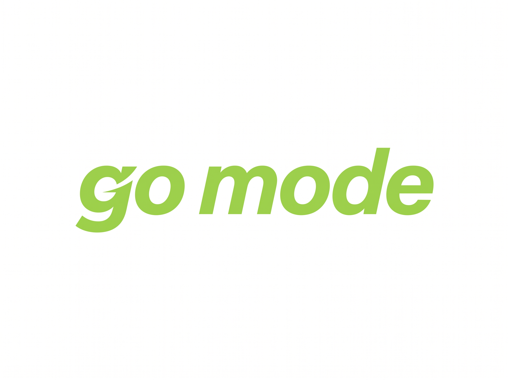

<div align="center">
  
  <h1>gomode</h1>
  <p><strong>Uncompromising Modern Apparel & Elevated Essentials</strong></p>
  
  <p>
    <a href="https://skillicons.dev">
      
    </a>
  </p>

  <p>
    
    
    
    
    
    
    
    
    
  </p>
</div>

---

## Overview

**GoMode** is an elevated contemporary apparel brand and digital commerce storefront headquartered in Accra, Ghana. Designed for those who move with intent, GoMode pairs structured outerwear, heavyweight denim, tactile knitwear, and commuter accessories with a minimalist, high-fashion aesthetic.

### Brand Aesthetic
- **Canvas**: Warm stone canvas (`#F5F3EF`)
- **Accent Color**: Signature Sage Green (`#668A53`)
- **Dark Ink**: Deep Graphite (`#111418`)
- **Typography**: Display typography (`Plus Jakarta Sans`) paired with geometric body styling (`Inter`)
- **Dividers & Borders**: Clean stone lines (`#E5E2DB`)
- **Identity**: Pure typographic text logo `gomode.`

---

## Features

### Storefront Experience
- **Innovative Text-Driven Hero Section**: Bold headline (**"OWN YOUR MODE."** with "MODE." highlighted in `#668A53`), live status ticker, interactive category triggers, and craftsmanship specs.
- **Architectural Marquee**: Continuous live ticker showcasing curated apparel drops and quality standards.
- **Curated Category Grid**: Visual exploration across *Outerwear*, *Denim & Jeans*, *Knitwear & Polos*, and *Accessories & Carry*.
- **Collection Archive**: Filterable catalog of curated pieces with real-time stock, tailored fit indicators, and instant quick-bag interactions.
- **Craft & Heritage Story**: Rich split-narrative highlighting authentic materials, ergonomic tailoring, and small-batch curation.
- **Verified Customer Reviews**: Testimonial section with 5-star ratings, purchaser verification badges, and authentic endorsements.
- **Trust & Logistics Pillars**: Next-Day Greater Accra Delivery, 30-Day Complimentary Size Exchanges, and Authenticity Assurances.
- **VIP Registry**: Newsletter subscription for private releases and exclusive small-batch drops.

### Shopping & Checkout
- **Currency**: Native Ghana Cedis (`GH₵` / GHC) with seamless conversion.
- **Cart & Bag**: Saved cart for authenticated users; seamless guest cart with automatic account merge upon sign-in.
- **Payments**: Paystack checkout supporting Mobile Money (MTN, Telecel, AT) and card transactions.
- **Order Tracking**: Real-time order lookup and fulfillment status timeline at `/track`.

### Comprehensive Admin Suite
- **Control Dashboard**: Metric cards, customer acquisition tracking, and sales analytics charts.
- **Catalog Management**: Add, update, and manage apparel pieces, size variants, stock thresholds, and categories.
- **Logistics**: Regional delivery rate configuration across all 16 regions of Ghana.
- **Timed Promotions**: Flash sale engine with automated percentage discounts and countdown banners.

---

## Reverse Proxy & Authentication Architecture

When deploying the frontend on **Vercel** (`https://gomode.vercel.app`) and backend API on **Render** (`https://gomode-api.onrender.com`), modern browsers block third-party cross-origin cookies.

GoMode solves this through an Edge Reverse Proxy in `client/vercel.json`:
```json
{
  "rewrites": [
    {
      "source": "/api/(.*)",
      "destination": "https://gomode-api.onrender.com/api/$1"
    },
    {
      "source": "/(.*)",
      "destination": "/index.html"
    }
  ]
}
```
All browser requests travel to `/api/...` on the same domain, guaranteeing that cookies (`sameSite: 'lax'`, `secure: true`, `httpOnly: true`) are preserved and treated as first-party by Safari ITP, Google Chrome, and iOS devices.

---

## Tech Stack

| Layer | Technologies |
| :--- | :--- |
| **Frontend** | React 18, Vite 7, styled-components, Lucide Icons, React Router 7 |
| **Data Fetching** | TanStack Query v5, Axios |
| **Backend API** | Node.js (v20+), Express 5 |
| **Database & ORM** | Neon Serverless PostgreSQL, Prisma 6 |
| **Authentication** | Better Auth (session cookies, email/password) |
| **Payments** | Paystack inline checkout |
| **Asset Storage** | Cloudinary & local high-resolution webp/avif assets |
| **Deployment** | Vercel (Frontend + Edge Rewrites), Render (API Web Service) |

---

## Local Development Setup

### Prerequisites
- Node.js `20.x` or higher
- PostgreSQL database (e.g. Neon connection string)

### 1. Backend Setup
```bash
cd server
cp .env.example .env
npm install
npx prisma db push
npm run dev
```

### 2. Database Seeding
To populate the 15 GoMode apparel pieces, categories, Ghana delivery rates, and the admin account:
```bash
cd server
node scripts/seedGomodeCatalog.js
```
*Default Admin Credentials:* `admin@gomode.com` / `Admin1234!`

### 3. Frontend Setup
```bash
cd client
cp .env.example .env
npm install
npm run dev
```
Open [http://localhost:5173](http://localhost:5173) in your browser.

---

## Production Deployment

For complete, step-by-step instructions on deploying to **Vercel**, **Render**, and **Neon**, refer to the deployment manual:
👉 [**deployment.txt**](deployment.txt)

---

## License

Private repository — © 2024–2026 GoMode. All rights reserved.
