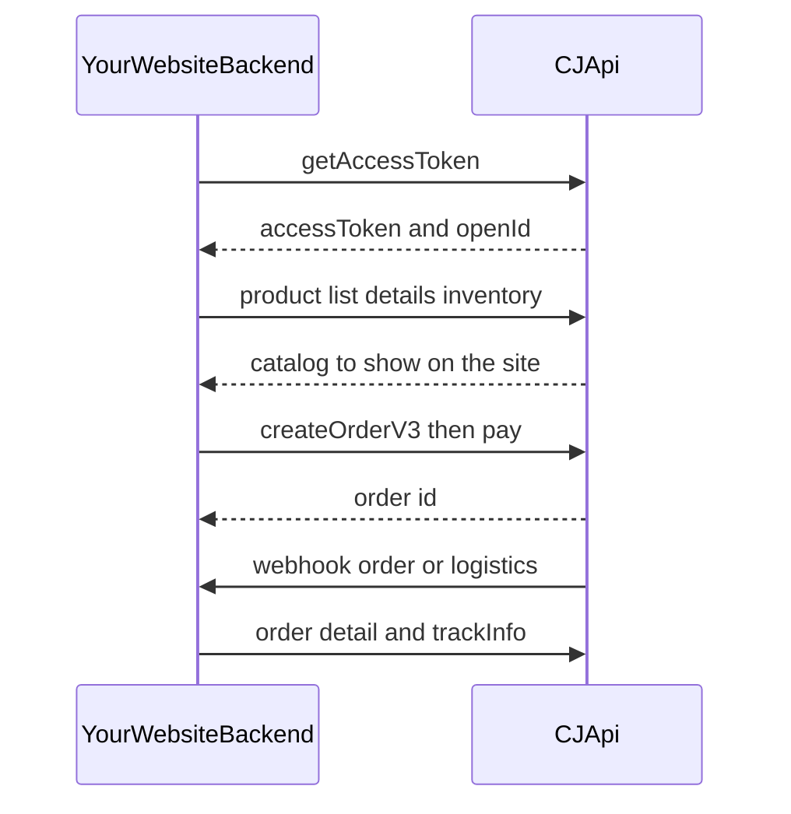

# Connect CJ Dropshipping to your website

This guide explains how the CJ Dropshipping API 2.0 works and how to connect it to a website you own. It is a connection manual: the steps, the rules, and the endpoints you need first. Field-level details stay on the official pages linked in each section.

Official documentation: [Development](https://developers.cjdropshipping.cn/en/api/start/development.html)

API host (every call): `https://developers.cjdropshipping.com`

The docs site uses `.cn`. The API host uses `.com`. Calls are HTTPS, JSON, and UTF-8. URL paths are case-sensitive.

## How a connection works

Your website never talks to CJ from the browser. A backend you control holds the API key, asks CJ for an access token, lists products, creates orders when a customer checks out, and receives webhooks when an order or a product changes.



Recommended path for a custom store:

1. Create an API key in the CJ account and store it only on the server.
2. Exchange it for an access token and cache the token.
3. Sync categories, products, variants, and stock into your catalog.
4. On checkout, create an order with CJ logistics (`shopLogisticsType=2`), pay it from the CJ balance, then track it.
5. Register HTTPS webhooks so you do not have to poll for every status change.
6. Prove the flow with sandbox orders before you spend real balance.

## Source map

Use this list to open the official page for a topic. The development guideline on the intro page is: Development, then Get Access Token, then API 2.0.

### Start

| Page | Use it for |
| --- | --- |
| [Introduction](https://developers.cjdropshipping.cn/en/api/introduction.html) | What the docs cover |
| [Development](https://developers.cjdropshipping.cn/en/api/start/development.html) | Call shape, success rule, and the overall flow |
| [Get Access-token](https://developers.cjdropshipping.cn/en/api/start/token.html) | Where to keep the token and when to refresh it |
| [Practical Tool](https://developers.cjdropshipping.cn/en/api/start/utils.html) | Trying calls in Postman |
| [Orders Synchronization Processing](https://developers.cjdropshipping.cn/en/api/start/Orders-Synchronization-Processing.html) | The three ways to send an order to CJ |
| [Products Synchronization Processing](https://developers.cjdropshipping.cn/en/api/start/Products-Synchronization-Processing.html) | How to pull the catalog onto your site |
| [Webhook](https://developers.cjdropshipping.cn/en/api/start/webhook.html) | Push payloads and signature checks |
| [Sandbox](https://developers.cjdropshipping.cn/en/api/start/sandbox.html) | Fake orders that do not charge real balance |
| [Interface Call Restrictions](https://developers.cjdropshipping.cn/en/api/start/limit.html) | Requests per second |
| [Points Resource Rules](https://developers.cjdropshipping.cn/en/api/api2/standard/points.html) | Daily points budget |
| [MCP Integration](https://developers.cjdropshipping.cn/en/api/api2/mcp.html) | Optional AI-tool access. A normal website uses the HTTP API below |

### Standard

| Page | Use it for |
| --- | --- |
| [Interface Definition](https://developers.cjdropshipping.cn/en/api/api2/standard/definition.html) | URL parts, required headers, shared response fields |
| [Interface Field Definition](https://developers.cjdropshipping.cn/en/api/api2/standard/field.html) | Shared field meanings |
| [Appendix 1: Global Error Codes](https://developers.cjdropshipping.cn/en/api/api2/standard/ps-code.html) | What `code` means when a call fails |
| [Appendix 2: Country Code](https://developers.cjdropshipping.cn/en/api/api2/standard/ps-country.html) | Two-letter country codes for shipping |
| [Appendix 3: Platforms](https://developers.cjdropshipping.cn/en/api/api2/standard/ps-Platforms.html) | Allowed `platform` values |
| [Appendix 4: Product Logistics Property](https://developers.cjdropshipping.cn/en/api/api2/standard/ps-product-property.html) | Battery, liquid, and similar shipping properties |

### Interface

| Page | Use it for |
| --- | --- |
| [1 Authentication](https://developers.cjdropshipping.cn/en/api/api2/api/auth.html) | Get, refresh, and logout tokens |
| [2 Setting](https://developers.cjdropshipping.cn/en/api/api2/api/setting.html) | Account profile fields such as open name and email |
| [3 Product](https://developers.cjdropshipping.cn/en/api/api2/api/product.html) | Categories, lists, details, variants, stock |
| [4 Storage](https://developers.cjdropshipping.cn/en/api/api2/api/storage.html) | Warehouses, used when you upload your own waybill |
| [5 Shopping](https://developers.cjdropshipping.cn/en/api/api2/api/shopping.html) | Create, pay, and read orders |
| [6 Logistic](https://developers.cjdropshipping.cn/en/api/api2/api/logistic.html) | Freight quotes and tracking |
| [7 Dispute](https://developers.cjdropshipping.cn/en/api/api2/api/dispute.html) | After-sale disputes |
| [8 Webhook](https://developers.cjdropshipping.cn/en/api/api2/api/webhook.html) | Register callback URLs |
| [9 Shop](https://developers.cjdropshipping.cn/en/api/api2/api/shop.html) | Shop records on the CJ account |
| [10 Ticket](https://developers.cjdropshipping.cn/en/api/api2/api/ticket.html) | Support tickets |

Setting, Storage, Dispute, Shop, and Ticket are available after you have a token. A first connection needs Authentication, Product, Shopping, Logistic, and Webhook.

## How a call works

Source: [Interface Definition](https://developers.cjdropshipping.cn/en/api/api2/standard/definition.html) and [Development](https://developers.cjdropshipping.cn/en/api/start/development.html).

A URL is four parts:

```text
https://developers.cjdropshipping.com / api2.0 / v1 / {uri}
```

Example: `POST https://developers.cjdropshipping.com/api2.0/v1/authentication/getAccessToken`

Headers on business calls:

| Header | Required | Value |
| --- | --- | --- |
| `Content-Type` | Yes on requests with a body | `application/json` |
| `CJ-Access-Token` | Yes, except when getting or refreshing a token | The `accessToken` from authentication |

Getting a token sends the API key in the JSON body and does not send `CJ-Access-Token`.

Every response uses the same envelope:

| Field | Meaning |
| --- | --- |
| `code` | Result code. `200` means success |
| `result` | `true` when the call succeeded |
| `message` | Human text. It can change, so do not branch on it |
| `data` | The payload. Shape depends on the endpoint |
| `requestId` | Id to log when you ask CJ about a failure |
| `success` | `true` when the call succeeded |

Success rule:

- Success: HTTP status is 200, and `code` is 200 or the `code` field is absent.
- Failure: HTTP status is not 200, or `code` is present and is not 200.

Log `requestId` and `code` on every failure. Look up `code` in [Global Error Codes](https://developers.cjdropshipping.cn/en/api/api2/standard/ps-code.html).

By default an endpoint only returns data for the CJ account that owns the token.

## Get an API key

Source: [Authentication](https://developers.cjdropshipping.cn/en/api/api2/api/auth.html).

1. In the CJ account, open Apps, then Install App.
2. In the App Store, under Others, install API. A green check means it is already installed.
3. Open the API authorization page and choose Add API.
4. Set a name and set Type to API Key, then confirm.
5. On the row whose Type is API Key, copy the value in the API Key & MCP Token column.

The key looks like `CJUserNum@api@...`. Put it in a server secret (environment variable or a secrets manager). Do not commit it, and do not send it to the browser.

An MCP token is a different credential, used by the [MCP Integration](https://developers.cjdropshipping.cn/en/api/api2/mcp.html) guide for AI clients. A website integration uses the API Key.

## Token flow

Sources: [Authentication](https://developers.cjdropshipping.cn/en/api/api2/api/auth.html) and [Get Access-token](https://developers.cjdropshipping.cn/en/api/start/token.html).

### Get a token

`POST /api2.0/v1/authentication/getAccessToken`

```json
{
  "apiKey": "CJUserNum@api@xxxxxxxxxxxxxxxxxxxxxxxxxxxxxxxxxx"
}
```

A successful `data` object contains:

| Field | Keep it |
| --- | --- |
| `openId` | Yes. Account id, and the secret you use to verify webhooks |
| `accessToken` | Yes. Send this as `CJ-Access-Token` |
| `accessTokenExpiryDate` | Yes. Refresh before this time |
| `refreshToken` | Yes. Used only to refresh |
| `refreshTokenExpiryDate` | Yes. When this passes, call get-token again |
| `createDate` | Optional |

The authentication page says both the access token and the refresh token last 180 days. The older Get Access-token page says the access token lasts 15 days and the refresh token lasts 180 days. Do not hardcode either number. Read `accessTokenExpiryDate` and `refreshTokenExpiryDate` from the response and refresh from those timestamps.

Calling get-token again for the same account within 24 hours returns the same cached `accessToken` and `refreshToken`. The refresh endpoint does the same inside that window. After 24 hours, or after logout, CJ issues a new pair. The get-token call itself is rate-limited like other endpoints: 1 request per second.

### Refresh

`POST /api2.0/v1/authentication/refreshAccessToken`

```json
{
  "refreshToken": "xxxxxxxxxxxxxxxxxxxxxxxxxxxxxxxxxxxx"
}
```

Replace the stored access token, refresh token, and both expiry dates with the new values.

### Logout

`POST /api2.0/v1/authentication/logout`

Header: `CJ-Access-Token: <accessToken>`

Logout expires both tokens. The next call must use the API key again.

### Rules for your server

- Cache the access token and reuse it. Do not call get-token on every product or order request.
- Check the expiry before each use. If the access token is expired and the refresh token is still valid, refresh. If both are expired, call get-token with the API key.
- Keep the API key, both tokens, and `openId` on the server. The start guide states that the access token must not be returned to the front end, and that all CJ calls start from your backend.
- One CJ account is enough for one website. Each IP address may authenticate at most three CJ users.

You can rehearse get-token in Postman using the host `https://developers.cjdropshipping.com`. See [Practical Tool](https://developers.cjdropshipping.cn/en/api/start/utils.html).

## Limits

### Requests per second

Source: [Interface Call Restrictions](https://developers.cjdropshipping.cn/en/api/start/limit.html).

| Limit | Value |
| --- | --- |
| Per IP address | 10 requests per second |
| Non-login interfaces | 30 requests per second |
| Users per IP | 3. Extra users get `one ip limit 3 users` |
| Free, or sales level 0 or 1 | 1 request per second |
| Plus, or sales level 2 | 2 requests per second |
| Prime, or sales level 3 | 4 requests per second |
| Advanced, or sales level 4 or 5 | 6 requests per second |

The get-token endpoint uses that same per-account rate (1 request per second on a free account) and the 24-hour token cache described above.

Space catalog and order calls out. A tight loop over product pages will hit the per-second cap before it hits the daily points cap.

### Daily points

Source: [Points Resource Rules](https://developers.cjdropshipping.cn/en/api/api2/standard/points.html).

CJ replaced the old daily call-count cap with points. For accounts registered on or after 1 June 2026 this is already in effect. For older accounts it takes effect on 1 July 2026. Until that date, the older QPS and daily call limits still apply to that account.

Daily total = 50,000 base points + order conversion. Conversion is the maximum transaction amount of the last 3 months, in USD, times 100. The total resets at 00:00 UTC. Points also refill during the day at `total / 1440` per minute, and available points never rise above the daily total.

Calls that are not in the cost table below do not spend points. Costs that matter while connecting a store:

| Endpoint | Points |
| --- | --- |
| `/product/listV2`, `/product/list` | 50 |
| `/product/query`, variant queries, most stock queries, `/product/stock/getInventoryByPid` | 10 |
| `/logistic/freightCalculate`, `/logistic/freightCalculateTip` | 10 |
| `/product/queryProductsByImage` | 1000 |

When points are not enough for the call, CJ returns HTTP 429:

```json
{
  "code": 429,
  "result": false,
  "message": "Insufficient API points. Used today: 50000, Remaining: 0, Required: 10",
  "pointsInfo": {
    "usedToday": 50000,
    "remaining": 0,
    "total": 50000
  }
}
```

Successful responses include `pointsInfo` (`usedToday`, `remaining`, `total`). Watch `remaining` while you run a full catalog sync.

If the CJ account has no transaction amount for 30 days in a row, API access is suspended. A reminder email goes out after 7 days with no transactions. Reactivate it from the API page in the CJ account.

## Products on your website

Source: [Products Synchronization Processing](https://developers.cjdropshipping.cn/en/api/start/Products-Synchronization-Processing.html). Endpoint details: [Product](https://developers.cjdropshipping.cn/en/api/api2/api/product.html).

Pull products from CJ into your database, then render your own pages from that database. Do not call CJ on every page view.

| Step | Endpoint | Why |
| --- | --- | --- |
| 1. Token | `POST /api2.0/v1/authentication/getAccessToken` | Authorize the rest |
| 2. Categories (optional) | `GET /api2.0/v1/product/getCategory` | Map CJ categories onto your own |
| 3. Product list | `GET /api2.0/v1/product/listV2` | Page through the catalog. Example query: `page=1&size=20&keyWord=hoodie` |
| 4. Product details | `GET /api2.0/v1/product/query?pid={pid}` | Description, images, and basic variant data. `pid` is the product id from the list |
| 5. Variants (optional) | `GET /api2.0/v1/product/variant/query?pid={pid}` | Use this when product details do not include every variant |
| 6. Inventory | `GET /api2.0/v1/product/stock/getInventoryByPid?pid={pid}` | Stock before you show the product as available |

`list` (not `listV2`) also exists. The sync guide uses list v2. Both cost 50 points per call, so page with a modest `size` and persist each page before requesting the next.

Save a map from your product and variant ids to CJ ids:

- Product: your id, CJ `pid`, title, images, category.
- Variant: your variant id, CJ `vid`, CJ `sku`, price, options.
- Stock: quantity by warehouse or country, refreshed on a schedule and when a stock webhook arrives.

`vid` is the variant id you send when you create an order with CJ's own catalog (`orderFlow=1`). `sku` is the fallback when you do not have `vid`.

Before showing a shipping price, call freight calculate. It costs 10 points.

`POST /api2.0/v1/logistic/freightCalculate`

You need weight, volume, and the destination country code from [Country Code](https://developers.cjdropshipping.cn/en/api/api2/standard/ps-country.html). The returned logistics name is what you later send as `logisticName`. Product shipping traits (battery, liquid, and similar) are listed in [Product Logistics Property](https://developers.cjdropshipping.cn/en/api/api2/standard/ps-product-property.html).

## Orders from your website

Source: [Orders Synchronization Processing](https://developers.cjdropshipping.cn/en/api/start/Orders-Synchronization-Processing.html). Endpoint details: [Shopping](https://developers.cjdropshipping.cn/en/api/api2/api/shopping.html).

When a customer pays you, your backend creates the matching CJ order. CJ fulfills it. You then show CJ's status and tracking on your order page.

Create Order V3 is the current create call:

`POST /api2.0/v1/shopping/order/createOrderV3`

Header `platformToken` is optional. Leave it empty unless your account requires it. Allowed `platform` names are in [Platforms](https://developers.cjdropshipping.cn/en/api/api2/standard/ps-Platforms.html). For a site that is not Shopify or another listed platform, confirm the value CJ expects before you go live.

Shipping fields you should expect to send: customer name, phone, email, country, country code, province, city, address lines, zip, and house number when the country uses one. Country codes are two letters (`US`, `GB`, and so on).

`payType=3` creates the order only. It does not pay, add to cart, or confirm. The flows below are the full path that ends in fulfillment.

### Path A — CJ logistics (use this for your own site)

CJ picks the carrier and ships the parcel. You do not upload a label.

On create:

- `shopLogisticsType` = `2`
- `storageId` empty
- `logisticName` set to a name returned by freight calculate (for example a CJPacket service)
- `orderFlow` = `1` (default) and each line has a CJ `vid` or CJ `sku`
- `fromCountryCode` is the ship-from country, often `CN`

Then, in order:

1. `POST /api2.0/v1/shopping/order/addCart`
2. `POST /api2.0/v1/shopping/order/addCartConfirm`
3. `POST /api2.0/v1/shopping/order/saveGenerateParentOrder` — returns the parent order, the amount due, and a payment id
4. `POST /api2.0/v1/shopping/pay/payBalanceV2` — pays from your CJ balance. You can also pay in bulk in the CJ website
5. `GET /api2.0/v1/shopping/order/getOrderDetail?orderId={orderId}` — status, tracking number, tracking URL
6. `GET /api2.0/v1/logistic/trackInfo?trackNumber={trackNumber}` — scan events. Repeat the query parameter to ask for several numbers. The older `/logistic/getTrackInfo` path is deprecated

Check the balance first with `GET /api2.0/v1/shopping/pay/getBalance` so a checkout does not fail at the pay step.

### Path B — you upload the waybill

Use this when your site or another carrier produces the label, and a CJ warehouse only packs the goods.

On create:

- `shopLogisticsType` = `1` or `3`
- `storageId` set to the warehouse. It cannot be changed after create

Before create, read stock with `GET /api2.0/v1/product/stock/getInventoryByPid` and warehouse data from the storage APIs (`GET` warehouse detail is the step named in the sync guide). See [Storage](https://developers.cjdropshipping.cn/en/api/api2/api/storage.html).

After the same cart, confirm, parent-order, and pay steps, the warehouse waits for your label:

- `POST /api2.0/v1/shopping/order/uploadWaybillInfo` after payment
- `POST /api2.0/v1/shopping/order/updateWaybillInfo` only while status is `UNSHIPPED`

### Path C — send your store's product ids

Use this when you do not yet know the CJ `vid` for a product the customer bought.

You must use Create Order V3 (V2 does not support this). Set `orderFlow` to `2` and send all three of these on each line:

| Field | What to put in it |
| --- | --- |
| `products[].vid` | Your store variant id (under this flow it is not the CJ variant id) |
| `products[].storeProductId` | Your store product id |
| `products[].storeProductImg` | Your store product image URL |

If that store product is already linked to a CJ product, the order shows under Imported → Orders and can be processed. If it is not linked, CJ still accepts the order, creates a store-product record, and files the order under Imported → Invalid Orders. You then link it on the My CJ Unconnected page, or ahead of time with the store-product APIs described in section 3.7 of the orders sync guide (save the store product, save variants in batch, create the connection, or disconnect it). The API does not notify you that a product is unlinked.

Some accounts are switched to store-order flow by CJ even when you omit `orderFlow`. Confirm that with your CJ contact.

The steps after create are the same as Path A or Path B, depending on `shopLogisticsType`.

### Order status

Read status from `getOrderDetail` or from the order webhook. Values:

| Status | Meaning |
| --- | --- |
| `CREATED` | Created |
| `IN_CART` | In the CJ cart |
| `UNPAID` | Not paid |
| `UNSHIPPED` | Paid, not yet shipped. `subStatus` is `PENDING` (codes 300–399) or `PROCESSING` (codes 400–499) |
| `SHIPPED` | In transit |
| `DELIVERED` | Delivered |
| `CANCELLED` | Cancelled |

`PENDING` and `PROCESSING` are sub-statuses of `UNSHIPPED`, not replacements for it. Batch order query (`POST /api2.0/v1/shopping/order/getOrderDetailBatch`, up to 100 ids) now returns the same `UNSHIPPED` plus `subStatus` shape. Ids that are missing or belong to another account are omitted, so match rows by the CJ order code. Batch query is limited to 2 requests per second per account and does not return logistics timeliness; use the single-order call for that.

Save your checkout id and the CJ order id together as soon as create returns.

## Webhooks

Sources: [Webhook mechanism](https://developers.cjdropshipping.cn/en/api/start/webhook.html) and [Webhook API](https://developers.cjdropshipping.cn/en/api/api2/api/webhook.html).

Polling still works. Webhooks are how you hear about product edits, stock changes, and shipment updates without a constant timer.

### Register

`POST /api2.0/v1/webhook/set`

Each topic is an object with `type` (`ENABLE` or `CANCEL`) and `callbackUrls`. Only one URL is allowed, and it must be a public HTTPS address. `localhost` and `127.0.0.1` are rejected.

Topics:

| Topic | What arrives |
| --- | --- |
| `product` | Product and variant inserts, updates, and deletes |
| `stock` | Inventory by variant and warehouse |
| `order` | Order status changes. Private outbound orders use this topic too, with `privateOutboundOrder: true` on insert |
| `logistics` | Tracking updates |
| `makeup` | Extra message type in the set-webhook body |
| `privateOrder` | Private-order messages |

For a store connection, enable `product`, `stock`, `order`, and `logistics`.

CJ calls your URL with `POST` and `Content-Type: application/json`. Respond with HTTP 200 within 3 seconds. Do the database work after you have acknowledged the request, or keep that work very small.

### Verify the signature

Every push has a `sign` header. Compute HMAC-SHA256 over the raw request body, using the decimal string of your `openId` as the secret, then Base64-encode the digest (keep the padding). Accept the request only when that string equals `sign`.

Sign the exact bytes CJ sent. Parsing JSON and writing it back out changes key order and breaks the check. The secret is `openId`, not the API key. `openId` is not in the headers.

`openId` is also your account id. Do not put it in client logs, screenshots, or tickets. A leaked `openId` lets someone forge webhook signatures.

Product messages use `type` `PRODUCT` or `VARIANT`, and `messageType` `INSERT`, `UPDATE`, or `DELETE`. The `fields` array names what changed. Product status `3` is on sale and `2` is off sale. Variant status `1` is on sale and `0` is off sale.

Stock messages use `type` `STOCK`. Order messages include `orderNumber`, `cjOrderId`, `orderStatus`, `logisticName`, and `trackNumber`. Store `messageId` and ignore a repeat delivery of the same id.

## Sandbox

Source: [Sandbox](https://developers.cjdropshipping.cn/en/api/start/sandbox.html).

`isSandbox` defaults to `0` (a real order). Send `isSandbox=1` on create to make a sandbox order.

Sandbox orders:

- Use a simulated payment and do not deduct real balance
- Do not create real labels or real fulfillment
- Still show `isSandbox` on order queries
- Are the only orders accepted by the three simulation endpoints

| Endpoint | Effect |
| --- | --- |
| `POST /api2.0/v1/shopping/sandbox/simulatePay` | Moves an unpaid sandbox order to paid (status code 300) |
| `POST /api2.0/v1/shopping/sandbox/updateStatus` | Moves 300 → 400 → 500 → 600 → 700. You cannot skip or go backward |
| `POST /api2.0/v1/shopping/sandbox/updateTrackNumber` | Sets `trackNumber` on a paid sandbox order that is not closed. No label is created |

Run Path A end to end with `isSandbox=1` and these three calls before you point checkout at live create and `payBalanceV2`.

## Errors and reference data

On failure, store HTTP status, `code`, `message`, and `requestId`. Resolve `code` with [Global Error Codes](https://developers.cjdropshipping.cn/en/api/api2/standard/ps-code.html). Authentication failures you will see early:

| `code` | Meaning |
| --- | --- |
| `1601000` | User not found (bad API key) |
| `1600001` | Authentication failed (bad or expired access token) |
| `1600003` | Refresh token is invalid |
| `429` | Not enough API points for this call |

Also keep these appendices next to your shipping form:

- [Country Code](https://developers.cjdropshipping.cn/en/api/api2/standard/ps-country.html) for `shippingCountryCode` and `fromCountryCode`
- [Platforms](https://developers.cjdropshipping.cn/en/api/api2/standard/ps-Platforms.html) for the `platform` field
- [Product Logistics Property](https://developers.cjdropshipping.cn/en/api/api2/standard/ps-product-property.html) when a product cannot ship by the method you quoted

## What to store

| Record | Fields | Why |
| --- | --- | --- |
| Secrets | API key, access token, refresh token, both expiry times, `openId` | Server only. Never in the browser or in git |
| Product map | Your product id ↔ CJ `pid`; your variant id ↔ CJ `vid` and `sku` | Create-order lines and stock updates |
| Stock snapshot | Variant, warehouse or country, quantity, updated time | What you show as in stock |
| Order map | Your order number ↔ CJ order id, parent order id, payment id, `isSandbox` | Status, pay, and tracking |
| Webhook inbox | `messageId`, topic, processed time | Drop retries |

## Checklist

1. Install the API app and copy an API Key into server configuration.
2. Call get-token once, save `accessToken`, `refreshToken`, expiries, and `openId`.
3. Page through `listV2`, then details, variants, and inventory. Stop when `pointsInfo.remaining` gets low.
4. Quote shipping with `freightCalculate` and store the chosen `logisticName`.
5. Create a sandbox order (`isSandbox=1`, `shopLogisticsType=2`), run cart → confirm → parent order, then `simulatePay`, `updateStatus`, and `updateTrackNumber`.
6. Register public HTTPS webhooks for product, stock, order, and logistics. Reject any body whose `sign` does not match HMAC-SHA256 of the raw body with `openId`.
7. Switch checkout to live create and `payBalanceV2` only after the sandbox order reaches a shipped status and your order page shows the tracking number.
