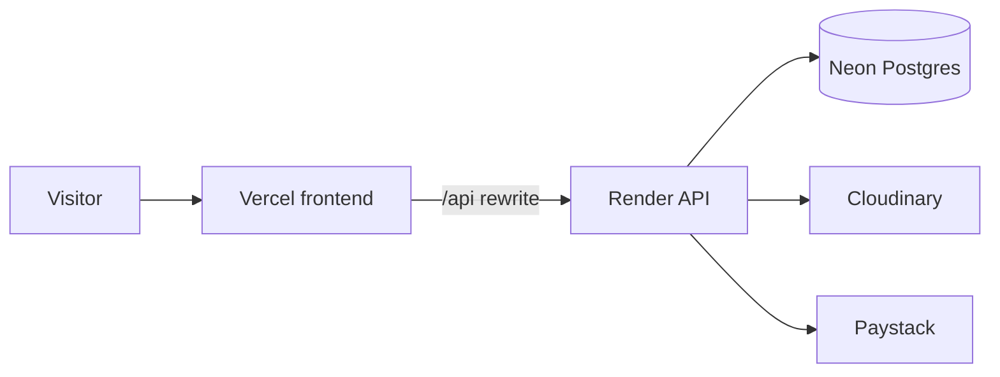

# Deployment

The shop is three hosted pieces:

- Frontend on [Vercel](https://vercel.com), root directory `client`
- API on [Render](https://render.com), root directory `server`
- Postgres on [Neon](https://neon.tech)

## Before you deploy

Gather your own accounts. Do not paste live keys into this file.

- Neon pooled URL and direct URL
- Cloudinary cloud name, API key, and API secret
- Paystack public and secret keys (test first, then live)
- Optional Google OAuth client
- Optional SMTP credentials for order mail
- Optional Redis URL, only if you have a real instance

## Database

Create a Neon project and copy both connection strings into the Render service:

- `DATABASE_URL` — pooled, used by the API
- `DIRECT_URL` — direct, used by `npx prisma migrate deploy`

The Render build runs `prisma migrate deploy` before the process starts. Seeding replaces the catalog. Run `npx prisma db seed` only when a fresh catalog is what you want.

## API on Render

Create a web service from [server/render.yaml](../../server/render.yaml), or create one by hand with root directory `server`.

- Build: `npm install && npm run build`
- Start: `npm start`
- Health check path: `/api/healthz`

`npm run build` generates the Prisma client and applies the migrations in `server/prisma/migrations`. It does not seed. `NODE_ENV` should be `production`. The server listens on `0.0.0.0` and on Render's `PORT`.

The blueprint lists every env var name and leaves the values empty. Fill them in the Render dashboard. Do not commit the values. Leave `REDIS_URL` unset.

Set these names. Values stay in the Render dashboard.

- `NODE_ENV` set to `production`. Render sets `PORT`.
- `DATABASE_URL`, `DIRECT_URL`
- `BETTER_AUTH_SECRET`, `BETTER_AUTH_URL`, `SESSION_SECRET`
- `FRONTEND_URL`, `CLIENT_URL` — the Vercel origin, so CORS allows the shop
- `PAYSTACK_SECRET_KEY`, `PAYSTACK_PUBLIC_KEY`
- `CLOUDINARY_CLOUD_NAME`, `CLOUDINARY_API_KEY`, `CLOUDINARY_API_SECRET`
- `CJ_API_KEY` — server only
- `GOOGLE_CLIENT_ID`, `GOOGLE_CLIENT_SECRET` — optional
- `SMTP_HOST`, `SMTP_PORT`, `SMTP_USER`, `SMTP_PASS` — optional

Leave `REDIS_URL` unset unless the URL points at a real Redis instance. The local default `redis://localhost:6379` is ignored on purpose. A fake Redis URL can take the cache client down.

On Render's free tier the service sleeps after inactivity. A scheduled ping of `GET https://your-app.onrender.com/api/healthz` every 14 minutes keeps it awake.

The same blueprint adds a cron service, `buyy-dashboard-stats`. Every 5 minutes (UTC) it runs `node cron/run.js`, refreshes the admin dashboard totals, and exits. It uses the API's `DATABASE_URL` and `DIRECT_URL`, and it still runs while the web service is asleep. Creating the Blueprint applies that job next to the API. Locally, `npm run dev` keeps the same 5-minute timer inside the API process.

## Storefront on Vercel

Import the repo. Framework preset Vite. Root directory `client`.

- Build command: `npm run build`
- Output directory: `dist`

The shop calls `/api` on its own host. The rewrite in `client/vercel.json` forwards that path to the Render API, so the browser treats the session cookie as first-party. Paystack webhooks still call the Render origin directly.

Environment variables:

- `VITE_PAYSTACK_PUBLIC_KEY` — the public key for the checkout popup

Redeploy after changing that variable. Vite bakes it in at build time.

## Google sign-in

If Google is enabled, the OAuth client needs:

- JavaScript origins for the Vercel site and the Render API
- Redirect URI `{BACKEND_URL}/api/auth/callback/google`

## After deploy

- `GET /api/healthz` returns OK
- The homepage loads at the Vercel URL and shows products
- Admin can sign in at `/login`
- Paystack checkout completes in test mode before live keys are used
- Paystack webhook URL is `{BACKEND_URL}/api/payments/webhook`
- Image upload works when Cloudinary keys are set
- The wake-up ping is running if the API is on the free tier
